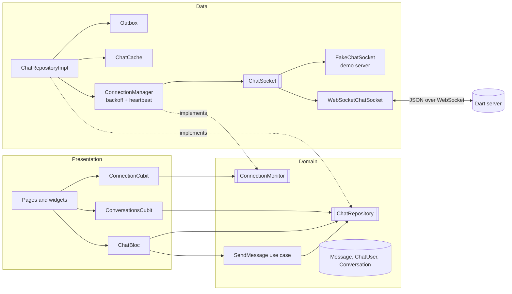
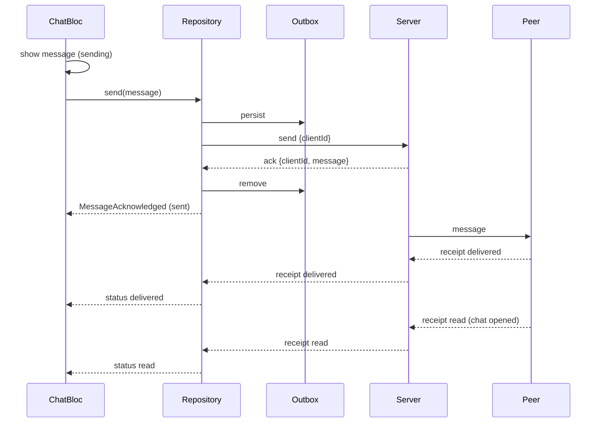

# flutter-realtime-chat

[](https://github.com/trsimanto/flutter-realtime-chat/actions/workflows/flutter.yml)

Real-time one-to-one chat over WebSocket, built with Flutter, Bloc and Clean Architecture.

The project covers what makes chat hard on mobile: messages show up the moment you hit send, ticks move from sending to read, typing and presence update live, and nothing you send gets lost when the network drops. It comes with a small Dart WebSocket server for running two emulators against each other, and a built-in demo mode with bot contacts, so the app also runs with no server at all.

## Features

- **Conversation list** with last message, delivery ticks, unread badges, live "typing..." and online dots
- **Chat screen** with message bubbles, day dividers, a typing indicator and online / last-seen status
- **Optimistic sends.** A message appears immediately as *sending* and is reconciled with the server copy when the ack arrives
- **Delivery states:** `sending -> sent -> delivered -> read`, plus `failed` with tap-to-retry. States only move forward, so a late or duplicate receipt can't undo a later one
- **Typing indicators** in both directions, debounced on the way out and auto-expiring on the way in
- **Presence:** online dots and "last seen" updated from server presence frames
- **Auto-reconnect** with exponential backoff and jitter (0.5s, 1s, 2s ... capped at 30s), a "Retry now" shortcut and a ping/pong heartbeat that catches connections that have gone quiet
- **Offline outbox.** Unacknowledged messages are kept on disk and resent in order after every reconnect. The server deduplicates by client id, so resending after a lost ack is safe
- **Pagination.** Older messages load as you scroll up, from the server when online and from the local cache when offline
- **Local cache.** Messages, contacts and unread counters are cached with `shared_preferences`, so the app opens with content on screen
- **Store-and-forward:** messages sent to an offline user are delivered in the `welcome` frame when they reconnect
- **Material 3** light and dark themes (system / light / dark toggle)
- **Demo mode:** an in-app server with bot contacts that ack, deliver, read, type and reply, plus a simulated network switch for showing off reconnects

## Tech stack

| Concern | Choice |
| --- | --- |
| UI | Flutter, Material 3 |
| State management | `flutter_bloc`: `Bloc` for the chat screen (events), `Cubit` for connection, conversations, session and theme |
| Dependency injection | `get_it`, with a scope per signed-in session |
| Transport | `web_socket_channel` behind a `ChatSocket` abstraction |
| Protocol | Hand-written JSON frame models (`sealed` classes, `fromJson` / `toJson`) |
| Persistence | `shared_preferences` behind a `KeyValueStore` interface (write-through in-memory cache) |
| Value equality | `equatable` |
| Time | `clock` (lets tests control time) |
| Server | Pure `dart:io` (`HttpServer` + `WebSocketTransformer`) |
| Testing | `flutter_test`, `bloc_test`, `fake_async`, `package:test` for the server |
| CI | GitHub Actions with `subosito/flutter-action` |

## Architecture



- **Domain** is plain Dart: entities, repository contracts, the `SendMessage` use case and pure helpers such as `MessageList` (merge, ordering, status rules). It has no Flutter imports.
- **Data** owns the wire protocol and all I/O. `ConnectionManager` keeps a `ChatSocket` alive and decodes frames. `ChatRepositoryImpl` turns frames into domain `ChatUpdate`s, keeps the cache and outbox in sync, and makes sure nothing goes out before `hello`.
- **Presentation** depends only on domain contracts, so blocs and widgets are tested against a small hand-written fake repository.

### Message lifecycle



If the connection drops at any point before the ack, the message stays in the outbox and goes out again after the next `hello`.

### Protocol

Every frame is a flat JSON object with a `type`. Timestamps are milliseconds since epoch. Direct conversation ids are `dm:<a>:<b>` with both user ids sorted, so both sides compute the same id.

| Direction | `type` | Fields | Purpose |
| --- | --- | --- | --- |
| client -> server | `hello` | `userId`, `name` | Authenticate the connection. Must come first |
| client -> server | `send` | `clientId`, `conversationId`, `to`, `text`, `sentAt` | Send a message. Idempotent per `clientId` |
| client -> server | `typing` | `conversationId`, `to`, `isTyping` | Typing started / stopped |
| client -> server | `receipt` | `conversationId`, `to`, `messageIds`, `status` | `delivered` or `read` |
| client -> server | `history` | `requestId`, `conversationId`, `before?`, `limit` | Page of older messages |
| client -> server | `ping` | | Heartbeat |
| server -> client | `welcome` | `user`, `users`, `conversations[]`, `pending[]` | Contacts, last message + unread per conversation, undelivered messages |
| server -> client | `ack` | `clientId`, `message` | Message stored. Carries the server id and timestamp |
| server -> client | `message` | `message` | New incoming message |
| server -> client | `typing` | `conversationId`, `userId`, `isTyping` | Peer typing |
| server -> client | `receipt` | `conversationId`, `userId`, `messageIds`, `status` | Peer received or read your messages |
| server -> client | `presence` | `user` (`id`, `name`, `online`, `lastSeen`) | Someone came online or went offline |
| server -> client | `history` | `requestId`, `conversationId`, `messages[]`, `hasMore` | Response to `history`, newest first |
| server -> client | `error` | `code`, `message`, `clientId?` | Rejected frame. With `clientId` the message is marked failed |
| server -> client | `pong` | | Heartbeat reply |

## Project structure

```
lib/
  core/
    di/injection.dart            # get_it setup, per-session scope
    storage/key_value_store.dart # persistence contract + in-memory impl
    theme/app_theme.dart         # Material 3 light/dark
    utils/                       # time formatting, id generation
  domain/
    entities/                    # Message, ChatUser, Conversation, ChatUpdate, ...
    repositories/                # ChatRepository, ConnectionMonitor, NetworkSimulator
    usecases/send_message.dart
    utils/                       # MessageList, ConversationIds
  data/
    protocol/                    # ClientFrame / ServerFrame + JSON mappers
    socket/                      # ChatSocket, WebSocketChatSocket, FakeChatSocket (demo)
    connection/                  # ConnectionManager, BackoffPolicy
    local/                       # ChatCache, Outbox, SessionStore, SharedPreferencesStore
    repositories/chat_repository_impl.dart
  presentation/
    chat/                        # ChatBloc (events/state), ChatPage, bubbles, composer
    conversations/               # ConversationsCubit, list page, tiles
    connection/                  # ConnectionCubit, reconnect banner
    session/  sign_in/  theme/  widgets/
  app.dart
  main.dart
server/
  bin/server.dart                # entry point
  lib/chat_server.dart           # relay, history, presence, store-and-forward
  test/chat_server_test.dart
test/
  data/                          # protocol, connection/backoff, repository + outbox, demo server
  domain/                        # status rules, merging, ids
  presentation/chat_bloc_test.dart
  widget_test.dart               # chat screen send flow
tool/bootstrap.dart              # recreates android/ and ios/ with the right app id
```

## Getting started

Requirements: Flutter 3.32 or newer (Dart 3.8+).

The repository keeps only the Dart sources, so the native folders are created on first checkout:

```bash
git clone https://github.com/trsimanto/flutter-realtime-chat.git
cd flutter-realtime-chat
flutter pub get
dart run tool/bootstrap.dart   # runs flutter create for android/ios and sets the app id dev.towhid.realtimechat
```

Plain `flutter create --org dev.towhid --project-name realtime_chat .` works too. It only adds missing files and never overwrites `lib/` or `test/`.

### Demo mode (no server)

```bash
flutter run
```

Enter any name, keep **Demo** selected and tap **Continue**. Some things to try:

- Chat with **Ava**. She replies, and you can watch the ticks go from sent to delivered to read.
- Scroll up in Ava's chat to page through older history.
- Open the menu and choose **Go offline**, send a few messages, then **Go online**. The outbox flushes in order.
- **Simulate connection drop** shows the reconnect banner and backoff.
- Message **Leo**. He is offline and comes online a few seconds later to reply.
- Send `/fail` to see a rejected message and tap-to-retry.

### Two devices against the local server

```bash
# terminal 1
cd server
dart pub get
dart run bin/server.dart --port 8080
```

```bash
# terminal 2 and 3, one per emulator or simulator
flutter run -d <device-id>
```

On each device choose **Local server**, enter a different name and connect:

| Device | URL |
| --- | --- |
| Android emulator | `ws://10.0.2.2:8080/ws` (pre-filled) |
| iOS simulator / desktop | `ws://localhost:8080/ws` (pre-filled) |
| Physical phone | `ws://<your-computer-LAN-IP>:8080/ws` |

The two users find each other automatically. A health check is available at `http://localhost:8080/health`.

## Testing

```bash
flutter analyze
flutter test

cd server && dart test
```

What is covered:

- **ChatBloc** (`bloc_test`): optimistic send, ack reconciliation, failure from both the repository and the server, retry, receipts that never move backwards, read marking, typing debounce and expiry, cache-then-network load, pagination
- **ConnectionManager** (`fake_async` with a fake socket and clock): exact backoff schedule, jitter bounds, retry countdown, reconnect after a drop, `retryNow`, heartbeat timeouts, stop
- **Repository and outbox**: hello always goes first, the outbox flushes in order on reconnect, ack removes entries, the outbox survives restarts, server rejections mark the message failed, unread counters and delivery/read receipts
- **Protocol**: round-trip serialization of every client and server frame and the exact wire format
- **Demo server**: welcome contents, ack/receipt/typing/reply sequence, dedup, simulated network loss
- **Widget**: the chat screen send flow from typing to ticks, and the typing indicator
- **Server**: relay + ack + receipts, idempotent resend, store-and-forward, presence, paged history, validation

## Roadmap

- [ ] Move the cache to a database (drift) for large histories and search
- [ ] Group chats with per-member receipts
- [ ] Media messages with upload progress
- [ ] Token-based auth instead of the trust-on-first-hello demo handshake
- [ ] Push notifications for background delivery
- [ ] Message edit / delete and reactions
- [ ] Integration tests driving two app instances against the real server

## Author

**Towhidur Rahman** — Lead Mobile Developer · [linkedin.com/in/trsimanto](https://www.linkedin.com/in/trsimanto)

## License

[MIT](LICENSE)
